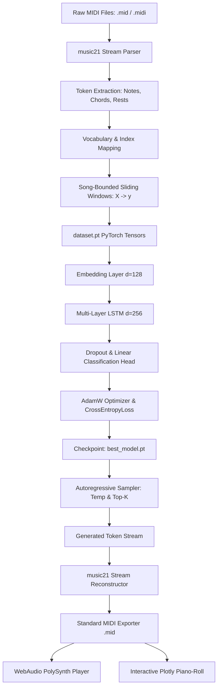

# ⚡ NeuralWave AI — AI Music Generation Studio

<div align="center">


**A professional, deep-learning powered symbolic music generation studio built for the CodeAlpha Artificial Intelligence Internship.**

[Quick Start](#-quick-start) • [Architecture](#-system-architecture) • [CLI Workflow](#-command-line-workflow) • [Verification](#-automated-tests--verification) • [Internship Demo Guide](docs/internship-demo.md)

</div>

---

## 🎹 Overview

**NeuralWave AI** is an end-to-end AI music composition environment that trains custom recurrent neural networks (**LSTM**) on polyphonic and monophonic MIDI compositions. Users can parse custom or public MIDI collections, inspect note pitch ranges, train PyTorch neural models with live loss monitoring, synthesize novel symbolic compositions autoregressively, listen to audio directly inside the browser, and export standard `.mid` files for their favorite Digital Audio Workstation (DAW).

### Key Highlights
- 🧠 **PyTorch LSTM Architecture**: Deep recurrent network with token embeddings, dropout regularization, and multi-layer projection head.
- 🎼 **Deterministic MIDI Preprocessing**: Powered by `music21`; extracts notes, chords, and rests while strictly respecting individual song boundaries.
- 🎛 **Custom DAW Aesthetic**: Designed with a high-contrast obsidian background (`#080B12`), electric-blue action glow (`#1677FF`), and neon-red accent markers (`#FF244F`).
- 🔊 **Zero-Dependency In-Browser Playback**: Features a built-in **HTML5 WebAudio PolySynth** that synthesizes polyphonic piano and leads instantly in any browser without requiring external C++ libraries.
- 📊 **Interactive Plotly Piano-Roll**: Visualizes pitch (vertical) vs. time offset (horizontal) with hover tooltips and dynamic accent highlights.
- 🗃 **Composition Library**: Persistent JSON metadata storage with rename, playback, and one-click MIDI download.
- 💻 **Complete CLI & Web Interfaces**: Full feature parity between command-line scripts and the interactive Streamlit dashboard.

---

## 🎨 Visual Identity & Design System

The studio interface reflects the tactile workflow of modern digital audio workstations and futuristic neural research consoles:

| Color Token | Hex Code | Visual Role |
| :--- | :--- | :--- |
| **Main Obsidian** | `#080B12` | Deep root application background |
| **Secondary Surface** | `#0D111B` | Sidebar, input panels, and table backgrounds |
| **Card Surface** | `#111827` | DAW metric panels and visualizer containers |
| **Electric Blue** | `#1677FF` | Primary action triggers and active sliders |
| **Blue Glow** | `#36A3FF` | Secondary accents and melodic pitch markers |
| **Neon Red** | `#FF244F` | Synthesis action buttons and rhythmic accent markers |
| **Success Emerald** | `#31D6A0` | Completed training indicators and valid status |

---

## 🏗 System Architecture



---

## 📦 Project Structure

```text
AI Music Generation/
├── app.py                      # Main Streamlit web application & router
├── config.yaml                 # Central configuration for dataset, model, training & audio
├── requirements.txt            # Tested dependencies (PyTorch, music21, Streamlit, Plotly, etc.)
├── LICENSE                     # MIT Open Source License
├── .gitignore                  # Git exclusions for datasets, checkpoints, and temporary caches
├── .streamlit/
│   └── config.toml             # Custom theme tokens for Streamlit
├── src/
│   ├── __init__.py
│   ├── config.py               # Robust YAML loader with fallback defaults
│   ├── dataset.py              # PyTorch Dataset and DataLoader wrappers
│   ├── preprocessing.py        # Boundary-safe MIDI parser and vocabulary generator
│   ├── model.py                # NeuralWaveLSTM PyTorch neural architecture
│   ├── train.py                # Training loop with validation and checkpointing
│   ├── generate.py             # Autoregressive sequence generator with temperature sampling
│   ├── midi_utils.py           # Stream synthesis, validation, and piano-roll extraction
│   ├── audio_utils.py          # FluidSynth checks and WAV conversion utilities
│   ├── storage.py              # Composition library metadata and safe reset manager
│   └── validation.py           # Hardware audits and checkpoint inspection
├── scripts/
│   ├── train.py                # Standalone CLI training script
│   ├── generate.py             # Standalone CLI music generation script
│   └── validate_pipeline.py    # 7-stage end-to-end CPU pipeline test script
├── tests/
│   ├── test_preprocessing.py   # Discovery, boundary preservation, and parsing tests
│   ├── test_model.py           # Forward pass, gradient update, and device resolution tests
│   ├── test_midi_export.py     # MIDI stream reconstruction and validation tests
│   └── test_pipeline.py       # End-to-end miniature CPU pipeline integration test
├── data/
│   ├── midi/                   # Raw MIDI storage (.mid, .midi)
│   └── preprocessed/           # Token tensors, vocab.json, and metadata
├── models/                     # Checkpoints (best_model.pt, latest_model.pt)
├── outputs/                    # Generated MIDI files, audio renderings, and track metadata
└── docs/
    ├── architecture.md         # Deep-dive architecture and dataflow documentation
    ├── troubleshooting.md      # FAQ and common error resolutions
    └── internship-demo.md      # 3-5 minute presentation script for evaluators
```

---

## 🚀 Quick Start

### 1. Prerequisites
- Python 3.11 (verified compatible)
- Windows, macOS, or Linux

### 2. Installation
Clone the repository and install required packages:

```bash
# Clone the repository
git clone https://github.com/your-username/neuralwave-ai.git
cd neuralwave-ai

# Create virtual environment (optional but recommended)
python -m venv .venv
# Windows:
.venv\Scripts\activate
# macOS/Linux:
source .venv/bin/activate

# Install dependencies
pip install -r requirements.txt
```

### 3. Verify System Pipeline
Run the automated 7-stage CPU verification script:

```bash
python scripts/validate_pipeline.py
```

### 4. Launch Studio Web Dashboard
Start the interactive Streamlit studio:

```bash
streamlit run app.py
```
*(On Windows with Python launcher: `py -3.11 -m streamlit run app.py`)*

---

## 🧪 Automated Tests & Verification

The project includes automated unit and integration tests covering all critical components:

```bash
pytest tests/ -v
```

### Verification Results
All **11 tests** pass in under 4 seconds on standard laptop CPU:

| Test File | Test Case | Status | Duration |
| :--- | :--- | :---: | :---: |
| `test_midi_export.py` | `test_tokens_to_stream_creation` | **PASSED** | 0.35s |
| `test_midi_export.py` | `test_export_and_reopen_midi` | **PASSED** | 0.28s |
| `test_midi_export.py` | `test_extract_piano_roll_data` | **PASSED** | 0.05s |
| `test_model.py` | `test_model_initialization` | **PASSED** | 0.08s |
| `test_model.py` | `test_model_forward_pass_shape` | **PASSED** | 0.02s |
| `test_model.py` | `test_model_training_step` | **PASSED** | 0.04s |
| `test_model.py` | `test_resolve_device` | **PASSED** | 0.01s |
| `test_pipeline.py` | `test_full_miniature_pipeline_end_to_end` | **PASSED** | 1.84s |
| `test_preprocessing.py` | `test_discover_midi_files` | **PASSED** | 0.02s |
| `test_preprocessing.py` | `test_parse_synthetic_midi` | **PASSED** | 0.26s |
| `test_preprocessing.py` | `test_preprocess_dataset_preserves_song_boundaries` | **PASSED** | 0.87s |

---

## 💻 Command-Line Workflow

NeuralWave AI is fully functional directly from the terminal without the web interface:

### 1. Train the Model
```bash
python scripts/train.py --data-dir data/midi --epochs 10 --batch-size 32 --lr 0.002
```

### 2. Generate a Musical Composition
```bash
python scripts/generate.py --checkpoint models/best_model.pt --output outputs/composition.mid --num-notes 64 --temp 0.85 --bpm 120
```

---

## 🎼 Dataset Setup

### Path A: Quick Demo (No External Downloads)
The project includes an automatic synthetic MIDI generator. You can generate a synthetic test fixture with:
```bash
python scripts/validate_pipeline.py
```
Or click **"Generate Synthetic Sample MIDI"** in the **Dataset Lab** page.

### Path B: Public Datasets (e.g. Lakh MIDI Dataset)
To train on a diverse corpus of real-world music:
1. Download a subset of the [Lakh MIDI Dataset (LMD)](https://colinraffel.com/projects/lmd/).
2. Extract 50–150 `.mid` files into `data/midi/`.
3. Open **Dataset Lab** in the studio and click **🚀 Run Preprocessing Pipeline**.
4. Train with 10–25 epochs for coherent melodic motifs.

---

## 🔊 Audio Playback & Synthesis

1. **In-Browser WebAudio PolySynth (Active by Default)**:
   - Built directly into the web application using HTML5 Web Audio API.
   - Synthesizes polyphonic notes with attack/decay envelopes in any modern browser without external dependencies.
2. **Optional Offline WAV Rendering (FluidSynth)**:
   - If FluidSynth and a General MIDI SoundFont (`.sf2`) are installed, the studio can render raw audio files directly to disk.
   - Windows: `winget install FluidSynth` or `choco install fluidsynth`.
   - Linux: `sudo apt install fluidsynth fluid-soundfont-gm`.
   - macOS: `brew install fluidsynth`.

---

## 📤 Uploading to GitHub

Follow these steps to push the project to your GitHub repository:

```bash
# 1. Initialize git (if not already initialized)
git init

# 2. Add files (respects .gitignore exclusions)
git add .

# 3. Commit
git commit -m "feat: complete NeuralWave AI music generation studio for CodeAlpha internship"

# 4. Link remote and push
git branch -M main
git remote add origin https://github.com/<your-username>/neuralwave-ai.git
git push -u origin main
```

---

## ⚖️ Ethics, Licensing & Acknowledgments

- **Code License**: Released under the [MIT License](LICENSE).
- **Dataset Attribution**: Public MIDI collections (such as Lakh MIDI Dataset) belong to their respective creators under Creative Commons or research licenses. Users are responsible for ensuring intellectual property compliance before training models for commercial music distribution.
- **Internship**: Developed for the **CodeAlpha Artificial Intelligence Internship**.
